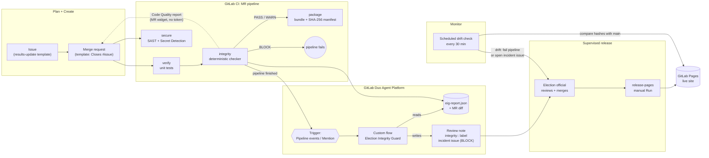

# Election Integrity Guard

**A supervised GitLab Duo agent workflow that stops bad merges from reaching an election website, explains why in plain language, and leaves the release decision to a human.**

**Live demo (fictional):** https://showcase-0b6166.gitlab.io: [results](https://showcase-0b6166.gitlab.io/results.html) and [voter information](https://showcase-0b6166.gitlab.io/voter-info.html).

> Built for the GitLab Transcend Hackathon. Path A: all code is new, written in October 2026. Autonomy level: **Supervised**.
> "Kanaloa County Elections" is **fictional**. Every county, candidate, number and domain in this repository is invented, and official links use the reserved `.example` domain.

<!-- SCREENSHOT: hero, with the MR !3 widget showing BLOCK and the Duo review comment side by side -->

## The problem

Election offices publish results and official voter information on ordinary websites, often from a Git repository. One bad merge can publish something that damages public trust within minutes:

- **Impossible numbers.** A hand-edited "recount" adds 1,500 votes to a candidate but not to the contest total.
- **A fake official link.** "Find your polling place" quietly points to `kanaloa-county.example` instead of `kanaloacounty.example`.
- **An injected script.** An "analytics tag" adds third-party JavaScript and loosens the Content Security Policy to let it run. Whoever controls that script controls what the results page shows.

The cause may be an honest mistake, a phished account, or an insider. On election night, a reviewer looking at a 3-line diff will not catch a single hyphen in a domain, or a CSP that grew one host.

## How it works



1. **Deterministic gate, in CI.** A stdlib-only Python checker runs on every MR pipeline. It returns `BLOCK`, `WARN` or `PASS`, and fails the pipeline on `BLOCK`. It writes three outputs:
   - `eig-report.json`, for the agent
   - `eig-report.md`, for people
   - a Code Quality report, which shows each finding in the MR widget on every GitLab tier
2. **Duo explains, in GitLab.** When an MR pipeline finishes, a **custom flow** on the GitLab Duo Agent Platform starts from a *Pipeline events* trigger. It reads the checker report and the MR diff, then:
   - posts **one** plain-language review (verdict, what changed, why it matters to voters, suggested fix)
   - sets an `integrity::block` / `integrity::warn` / `integrity::pass` label
   - opens an incident issue for BLOCK findings

   Mentioning the flow's service account in a comment asks for a fresh review. The flow cannot change the verdict.
3. **A human releases.** The agent's toolset has no merge, approve or deploy tool, and its service account has the Developer role on a protected `main`. A person merges, then presses **Run** on the manual `release-pages` job.
4. **The live site is watched.** A scheduled pipeline compares every live file's SHA-256 hash with the reviewed commit, and checks that commit is in `main`'s history. Any drift fails the pipeline, so tampering after deploy is visible.

**Why deterministic first, with AI on top?** Election integrity rules must be reproducible, fast and auditable, so the gate is plain code with 64 unit tests. The language model does what the code can't: it explains a finding to a non-engineer, ties it to the exact diff lines, and suggests the fix. It never overrides the gate.

### What the demo MRs show

| MR | Change (as the author described it) | Verdict | What was caught |
|---|---|---|---|
| [!1](https://gitlab.com/gitlab-ai-hackathon/transcend-october-2026/43545862/showcase/-/merge_requests/1) | "Correct Dana Ironwood count after precinct 17 recount" | **BLOCK** | Candidate votes sum to 30,902, but the contest total says 29,402 (RES-003). Also a +5.5 pp share swing (ANOM-001, WARN). |
| [!2](https://gitlab.com/gitlab-ai-hackathon/transcend-october-2026/43545862/showcase/-/merge_requests/2) | "Move polling-place lookup to the new vendor address" | **BLOCK** | `elections.kanaloa-county.example` imitates `kanaloacounty.example` (LINK-002) |
| [!3](https://gitlab.com/gitlab-ai-hackathon/transcend-october-2026/43545862/showcase/-/merge_requests/3) | "Add live visitor analytics to the results page" | **BLOCK** | Third-party script (ASSET-001), inline script (ASSET-002), and a CSP widened with a new host and `'unsafe-inline'` (CSP-002/003/004) |
| [!4](https://gitlab.com/gitlab-ai-hackathon/transcend-october-2026/43545862/showcase/-/merge_requests/4) | "Publish results update 4 (11:45 pm tally)" | **PASS** | Nothing. Shares moved by less than 1 pp, and the code-owner approval note applies. |

<!-- SCREENSHOT: Duo review comment on !2 (lookalike link) -->
<!-- SCREENSHOT: Code Quality widget on !3 showing 5 blockers -->

## DevSecOps stages covered

| Stage | What runs | Evidence |
|---|---|---|
| **Plan** | Issue templates for results updates and integrity incidents. Every MR must close an issue (rule GOV-001). | [`.gitlab/issue_templates/`](.gitlab/issue_templates), issues #2–#5 |
| **Create** | Default MR template (linked issue, supervised-release checklist); CODEOWNERS sections for results, policy, CSP and automation | [`.gitlab/merge_request_templates/Default.md`](.gitlab/merge_request_templates/Default.md), [`.gitlab/CODEOWNERS`](.gitlab/CODEOWNERS) |
| **Verify** | `verify` job: compile, JSON validation, 64 unit tests (every rule plus the four demo scenarios end to end) | [`checker/tests/`](checker/tests), job `verify` |
| **Secure** | `integrity` job: the deterministic checker (links, scripts, CSP, results). GitLab **SAST** and **Secret Detection** templates run in MR pipelines, even when the gate blocks. | [`checker/`](checker), jobs `integrity`, `semgrep-sast`, `secret_detection` |
| **Package** | `package` job: copies results into the site and writes `manifest.json` with the commit and a SHA-256 hash of each file | [`scripts/build_site.py`](scripts/build_site.py) |
| **Release** | `release-pages` (`pages: true`): only on `main`, only after a person presses **Run**, deployed to the `production` environment | [`.gitlab-ci.yml`](.gitlab-ci.yml) |
| **Configure** | Policy as code: allowlists, the anomaly threshold, the required CSP. Loosening any of them is itself flagged (CSP-006, ALLOW-001, POL-001/002). The Duo flow and agent configs are in the repo. | [`config/`](config), [`.gitlab/duo/`](.gitlab/duo) |
| **Monitor** | Scheduled pipeline every 30 min: live-site hashes compared with the reviewed commit, plus a record of the response headers | [`scripts/monitor_drift.py`](scripts/monitor_drift.py), schedule "integrity monitor" |
| **Govern** | Required issue link; CODEOWNERS must cover `/results/` and `/config/`; the code-owner note; a review comment and label on every MR as an audit trail; an agent with no merge, approve or deploy rights | [`checker/rules_governance.py`](checker/rules_governance.py), [`docs/duo-setup.md`](docs/duo-setup.md) |

## Integrity rules

| Area | Rules | Severity |
|---|---|---|
| Results arithmetic | Votes are non-negative integers; candidate votes sum to the contest total; precincts reporting ≤ total; ballots cast ≤ registered voters; turnout is 0–100% and matches the counts; a contest total is never above ballots cast | BLOCK |
| Anomalies, compared with the previous update | A vote-share swing larger than `config/policy.json → anomaly.max_share_swing_pp` (default 5 pp); vote counts or precincts going down; update sequence not increasing; candidate list changed | WARN |
| Official links | Must be HTTPS on an allowlisted domain (`config/allowlist.json`); lookalikes of official domains are blocked anywhere on the site (digit or homoglyph swaps, hyphens, extra words, punycode) | BLOCK |
| Scripts and assets | Third-party `<script>`, `<iframe>`, `<embed>` or `<object>` off the allowlist; inline `<script>`; inline `on*=` handlers; `javascript:` URLs | BLOCK |
| | `eval` / `new Function` / string timers; `innerHTML`-style sinks; third-party stylesheets | WARN |
| Security headers | CSP `<meta>` present on every page; required directives kept; no `'unsafe-inline'`, `*` or scheme wildcards; no widening against the MR base; `config/security-policy.json` never loosened | BLOCK |
| Governance | The MR must reference an issue; CODEOWNERS must cover `/results/` and `/config/`; changes to protected paths are noted for code-owner approval | BLOCK / INFO |

## Setup

### Run it locally

Requirements: Python 3.11+ and git. No third-party packages.

```bash
git clone https://gitlab.com/gitlab-ai-hackathon/transcend-october-2026/43545862/showcase.git
cd showcase

# Unit tests: rules, the four demo scenarios end to end, and the package and monitor scripts
python3 -m unittest discover -s checker/tests -t . -v

# Run the integrity checker against main, as the integrity CI job does
python3 -m checker --base origin/main --out-dir /tmp/eig --no-fail
cat /tmp/eig/eig-report.md

# Simulate an MR, including the "must reference an issue" rule
echo "Closes #2" > /tmp/mr.txt
python3 -m checker --base origin/main --mr-description-file /tmp/mr.txt --out-dir /tmp/eig

# Try a demo scenario locally
git checkout demo/2-polling-vendor
python3 -m checker --base origin/main --mr-description-file /tmp/mr.txt --out-dir /tmp/eig   # exit 1, LINK-002
git checkout main

# Build and preview the site, as the package job does
python3 scripts/build_site.py
python3 -m http.server -d public 8000            # http://localhost:8000

# Check the live demo for drift, as the monitor job does
git fetch origin && python3 scripts/monitor_drift.py --url https://showcase-0b6166.gitlab.io --main-ref origin/main --out-dir /tmp/eig
```

Checker exit codes:

| Code | Meaning |
|---|---|
| `0` | PASS or WARN |
| `1` | BLOCK |
| `2` | Configuration error |

### Set it up in your own GitLab project

1. **Copy the repo.** Push it to a GitLab project, then turn on Pages (Settings > General > Visibility).
2. **Run CI.** The pipeline works with no CI/CD variables. Optionally, add `EIG_BOT_TOKEN` (a masked, protected project access token with the Reporter role and `api` scope) so the monitor opens incident issues as well as failing.
3. **Create a pipeline schedule** on `main`, for example `*/30 * * * *`, with no variables. Every scheduled pipeline is a monitor run.
4. **Turn on the Duo flow and agent.** This needs the Maintainer role; follow [`docs/duo-setup.md`](docs/duo-setup.md):
   - In AI > Flows, create the flow from [`.gitlab/duo/flows/integrity-review.yml`](.gitlab/duo/flows/integrity-review.yml), then enable it.
   - In AI > Triggers, add **Pipeline events** (Passed, Failed) and **Mention**.
   - Optionally, create the **Integrity Advisor** custom agent for Duo Chat ([`.gitlab/duo/agents/integrity-advisor.md`](.gitlab/duo/agents/integrity-advisor.md)).
5. **Protect `main`.** Follow [`docs/ui-settings.md`](docs/ui-settings.md): protected `main`, code-owner approval, an approval rule, and "Pipelines must succeed".

## Known limits

- **CSP in a `<meta>` tag, so no `frame-ancestors`.** GitLab Pages can't set custom response headers, so the CSP ships as `<meta http-equiv>` on every page, and the checker enforces it. Browsers ignore `frame-ancestors` in a meta CSP, so clickjacking protection isn't possible on this hosting. A production deployment should serve the same policy as a real header, from a CDN or web server.
- **No HSTS on `*.gitlab.io`.** HSTS is a response header the repository can't control. The monitor records the live headers on every run, rather than pretending to enforce them.
- **The Developer role limited what could be enforced in this hackathon workspace.**
  - Branch rules, approval rules, protected environments, CI/CD variables and pipeline variables all need Maintainer. So the human release gate is a **manual `release-pages` job**, not a protected-environment approval, and the agent-independent fallback is a **Code Quality report**, not CI-applied labels.
  - "Pipelines must succeed" and code-owner approval are designed, documented and checked by the checker, but couldn't be switched on.
  - Creating, enabling and triggering the Duo flow also needs Maintainer.
  - <!-- STATUS: replace this bullet with "Enabled on <date> after Maintainer was granted" or "Shown via the VS Code flow builder (Plan B)" -->
- **Solo approver.** This is a one-person project, so the author also approves. In production, a separate election official is the required approver, "Prevent approval by author" stays on, and the Duo service account is never an eligible approver.
- **Static checks only.** The checker reads the repository; it doesn't render pages or run JavaScript. Obfuscated script loaders inside an allowlisted same-origin file would rely on SAST and human review.

## Repository layout

```
public/          fictional election site (static HTML + CSS + one JS file, no framework)
results/         results.json (current update) and history/ (earlier updates)
config/          allowlist.json, policy.json, security-policy.json (policy as code)
checker/         deterministic integrity checker (Python 3, stdlib only) and tests/
scripts/         build_site.py (package) and monitor_drift.py (monitor)
.gitlab/         CODEOWNERS, issue and MR templates, duo/flows and duo/agents
docs/            duo-setup.md, ui-settings.md, devpost.md, video-script.md
```

## License

[MIT](LICENSE) © 2026 Long Huu Nguyen
