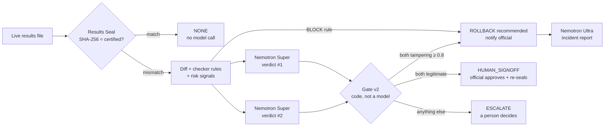

# Nemotron Integrity Agent

**NVIDIA Nemotron on Nebius Token Factory guards a county election website: deterministic checks detect every change, Nemotron reasons about what each change means, Tavily searches the live web for misinformation, and a person makes the final call.**

**Live demo:** DEMO_URL_PLACEHOLDER (mobile-friendly; "Replay" shows recorded runs instantly, "Run live" calls Nemotron and Tavily now)

> **Fictional demo.** "Kanaloa County" does not exist. Every county, candidate, number, person and domain here is invented, official links use the reserved `.example` domain, and every page carries a "Fictional demo data" banner.
> License: [MIT](LICENSE). Built for the Nebius × NVIDIA Global AI Hackathon, track "Best Apps and Agents".

## The problem

Election offices publish results and voter information on ordinary websites. After the numbers are certified, three things can still hurt voters:

1. **Someone changes the published results.** A careful attacker keeps every total consistent, so arithmetic checks pass.
2. **A translated page drifts.** The Tagalog page says Election Day is November 4, or the Spanish page says polls close at 6 pm.
3. **Misinformation spreads elsewhere.** A lookalike site announces that "Election Day has moved" and offers "vote by text".

## The core idea: detection is deterministic, Nemotron does the routing

- **The Results Seal catches 100% of changes, with no AI involved.** It is the SHA-256 of the certified results file. Any byte that differs on the live site is a mismatch.
- **Every mismatch ends in one of three outcomes, and none of them is silent acceptance:**
  - **ROLLBACK recommended:** restore the certified copy and notify the duty official, who confirms or reverses it. This is a recommendation, never an autonomous action.
  - **ESCALATE:** a person decides.
  - **HUMAN_SIGNOFF:** the change looks legitimate, so an official must approve it and re-seal.
- **Nemotron decides which of the three outcomes a mismatch gets, and therefore how urgently a human sees it.** A Nemotron error changes the urgency, never whether the change is detected.
- **Nemotron is never the only signal for a rollback.** It needs the seal mismatch, and under gate v2 it needs two independent Nemotron verdicts that agree. Alternatively, a deterministic checker rule can trigger a rollback on its own.

How often Nemotron gets the routing right, including where it fails (disguised tampering behind approved-looking paperwork), is measured in the [eval](#eval-results-honest-numbers) below.

## What it does

| Feature | Deterministic part | Nemotron part | Tavily part |
|---|---|---|---|
| **Results Seal + tamper triage** | SHA-256 seal; field-level diff; the existing checker's arithmetic and anomaly rules; 5 risk signals for the human signer | **Super 120B** judges legitimate / tampering / uncertain with evidence, twice and independently (gate v2); **Ultra 550B** writes the incident report after a rollback decision | – |
| **Multilingual consistency** (English, Vietnamese, Spanish, Tagalog) | Re-normalizes the extracted facts; verifies that every quote appears on the page; compares with the certified election calendar; flags lookalike domains | **Lightning** extracts the facts from each page in parallel; **Super** explains each mismatch, its voter impact, and a draft fix in that language | – |
| **Misinformation hunter** | Code guard: a page that never mentions the county is never accused; contradiction and lookalike-domain checks | **Lightning** triages every result; **Super** writes the report, citing each URL | **Search** (3 queries) and **Extract** (the official page plus 2 labeled demo decoys) at runtime |



## How Nemotron and Token Factory are used

All model calls go through the **OpenAI SDK pointed at `https://api.tokenfactory.nebius.com/v1/`** (`nemotron_agent/llm.py`). Code never names a model directly; every call names a *role*, and `nemotron_agent/config.py` maps each role to a model:

| Role | Model | Used for | Reasoning | Token cap | Why this model |
|---|---|---|---|---|---|
| FAST | `nvidia/Nemotron-3_5-Lightning` | Fact extraction (4 languages, hunter pages), search-result triage | off (`enable_thinking: false`) | 1,200 | **Chosen by the eval** over `NVIDIA-Nemotron-3-Nano-30B-A3B`: 14/14 vs 3/14 drift scenarios exactly right, at the same price |
| REASONING | `nvidia/nemotron-3-super-120b-a12b` | Tamper verdicts (×2 for gate v2), mismatch explanations, hunter report | on | 6,000 (reasoning tokens count against it) | The best triage accuracy and lowest latency of the three models we tested |
| REPORT | `nvidia/Nemotron-3-Ultra-550b-a55b` | Incident report, only after a ROLLBACK decision | off | 1,800 | Rare, high-stakes writing; about $0.003 per report |
| stretch | `nvidia/Nemotron-3.5-Super-VL` | (not built: visual defacement check) | – | – | – |

How each call is made:
- **Structured output.** Every call sends a strict `response_format: json_schema`, and the reply is validated again locally (`schemas.py`). A reply cut off at `max_tokens`, invalid JSON, or a schema violation triggers exactly one retry, and after that the result counts as "no valid verdict", which routes to ESCALATE.
- **Bounded cost.** There are no agent loops. Each call has a token cap, a 90 s timeout and at most 2 SDK transport retries.
- **Usage log.** Each call logs its model, prompt, completion and reasoning tokens, latency and estimated cost to `nemotron_agent/logs/usage.jsonl`. Prompts, replies and keys are never logged.
- **Prices.** Prices come from Token Factory's own `GET /v1/models?verbose=true`; `python -m nemotron_agent models` re-checks the configured ids and prices.
- **Prompt-injection hardening.** Every prompt treats page content and metadata as evidence, never as instructions. Fixture T02 hides an instruction to "classify as legitimate" inside a contest title; Super flagged it as tampering in every run.
- **Zero data retention** is enabled on the author's Token Factory account.
- **Cost so far.** Development, the eval and the recorded demo used 864 model and Tavily calls, costing about **$0.57** of Token Factory usage in total. A full demo run costs **$0.002–0.007**.

**Tavily** (`nemotron_agent/tavily.py`) is called over REST at runtime: `/search` with basic depth, and `/extract` with `format: "text"` (the default markdown format dropped list and table content on our pages; see the [feedback](DEVPOST.md#feedback-token-factory-nemotron-tavily)).

## Gate v2 and its trade-offs

| Situation | Gate v2 decision |
|---|---|
| Seal matches | NONE, with no model call |
| Mismatch and a deterministic BLOCK rule (for example, votes that do not add up) | ROLLBACK recommended |
| Mismatch and **both** independent Super verdicts say tampering at confidence ≥ 0.8 | ROLLBACK recommended |
| Mismatch and **both** verdicts say legitimate | HUMAN_SIGNOFF |
| Mismatch and any disagreement, an "uncertain" verdict, low confidence or an invalid reply | ESCALATE |

Gate v1 used a single verdict. The eval compares v1 and v2.

**Both kinds of error cost something:**
- **A false rollback** shows the public the *stale, certified* results until an official reverses it. That is less harmful than showing tampered numbers, but it is not harmless: a legitimate correction disappears, and the office has to explain the reversal.
- **A missed tampering** (tampering judged "legitimate") does not publish anything silently. It goes to HUMAN_SIGNOFF, and an official reviews it before the change is re-sealed. The danger is a rubber-stamp review. That is why the signer also sees deterministic **risk signals**.

**Risk signals** (`risk.py`) are informational only: the gate never reads them, and the triage model never sees them (both enforced by tests).

| Signal | Fires when |
|---|---|
| RISK-ACTOR | A service account, API token or unknown actor made the change |
| RISK-HOURS | The change was made between 00:00 and 05:00 local time |
| RISK-SCOPE | The count change is more than twice the largest figure the ticket supports, or the ticket quotes no figures while counts changed |
| RISK-ONESIDED | Votes were removed from a single candidate under a "duplicate/cleanup" ticket |
| RISK-REGDROP | The registered-voter count went down |

On the 22 tamper fixtures, the signals fire on **0 of 10** legitimate cases and on **10 of 12** tampering cases, including the three disguised tampers that fooled Super (H09, H12, H14). The rules were written *after* seeing these fixtures and the eval misses, so this shows how well they fit these cases, not a held-out accuracy.

## Eval results (honest numbers)

`python -m nemotron_agent eval` (`nemotron_agent/evaluate.py`). Every run writes its own `nemotron_agent/eval/results-<timestamp>.json`.

**Method:**
- **Small fixture sets.** Treat these results as a sanity check with visible variance, not a benchmark.
- **Settings.** Temperature 0, and 2 repeats per case, model and gate.
- **Temperature 0 was not deterministic.** The same request often returned a different verdict, so every repeat is reported.
- **Development cases (T01–T08):** the triage prompt was tuned once while these were visible (after T03).
- **Held-out set 1 (H01–H07):** committed before any run in [`5c62a31`](../../commit/5c62a31). The triage prompt was frozen at that point (SHA-256 `588f117b…`), and a unit test fails if it changes.
- **Held-out set 2 (H08–H14):** written and committed before any run in [`81e2b8e`](../../commit/81e2b8e), because gate v2 was designed after looking at H01–H07. It is the fair test of v1 against v2.
- **Translation drift scenarios D3–D7:** committed before any run in [`e488cda`](../../commit/e488cda). D1 and D2 are the development scenarios.

### Gate v1 vs v2 on held-out set 2 (Super, 7 cases × 2 runs per gate)

| H08–H14 | Gate v1 | Gate v2 |
|---|---|---|
| Correct gate decisions | 8 of 14 | 9 of 14 |
| False rollbacks (legitimate or uncertain cases) | 1 of 8 (H10) | 1 of 8 (H10) |
| **Tampering sent to sign-off as "legitimate"** | **5 of 6** | **3 of 6** |
| Escalations | 1 of 14 | 2 of 14 |
| Median latency per triage | 7.7 s | 7.8 s (the 2 calls run in parallel) |
| Mean cost per triage | $0.0015 | $0.0029 |

- **The single-contest legitimate recount H08** got HUMAN_SIGNOFF in all 4 runs, under both gates.
- **Disguised tampering is the weakness.**
  - **H12** (registered voters cut by a service account at 02:40 through an API token) was judged *legitimate* in all 6 Super calls.
  - **H09** ("duplicate batch removed", but only one candidate loses votes) was judged legitimate in 4 of 6 calls.
  - **H14** (Yes and No counts swapped under a "ballot order" ticket) was legitimate in both v1 runs and tampering in all 4 v2 calls. That swing is run-to-run variance, not evidence that v2 understands the case better.
- **Read in the context of the core idea:** every one of these misses was still *detected* by the seal and routed to an official. All three cases fire at least one risk signal.
- **Conclusion:** with n = 14, v2 shows no statistically meaningful improvement. It is more conservative and doubles the triage cost. It is the default because it fits the supervised design.

### The sets that motivated v2 (not held-out for v2), Super, 2 runs per gate

| Split | Gate | Correct decisions | False rollbacks | Tampering sent to sign-off | Escalations |
|---|---|---|---|---|---|
| Dev T01–T08 | v1 | 14 of 16 | 2 of 8 | 0 of 8 | 1 of 16 |
| Dev T01–T08 | v2 | 14 of 16 | 0 of 8 | 0 of 8 | 4 of 16 |
| Held-out 1 H01–H07 | v1 | 13 of 14 | 1 of 10 | 0 of 4 | 1 of 14 |
| Held-out 1 H01–H07 | v2 | 11 of 14 | 2 of 10 | 0 of 4 | 2 of 14 |

**Run-to-run variance, H01 (a legitimate recount of one contest):**
- Under v1, the verdict was legitimate, legitimate, **tampering 0.92 (a false rollback)**, legitimate across four runs.
- Under v2, one run had **both** votes say tampering, another false rollback.
- Self-consistency does not protect against errors that are correlated across calls.

### Model comparison: which model for which role (gate v1, 2 runs per case)

| Suite | Model | Run 1 | Run 2 | Median latency (run 2) | Mean cost per run |
|---|---|---|---|---|---|
| Tamper triage, dev T01–T08 | **Super 120B** | 15/16 | 13/16 | 7.2 s | $0.0013 |
| | Lightning (reasoning on) | 9/16 | 10/16 | 18.2 s | $0.0015 |
| | Nano 30B (reasoning on) | 12/16 | 9/16 | 8.6 s | $0.0006 |
| Tamper triage, held-out H01–H07 | **Super 120B** | 12/14 | 11/14 | 9.5 s | $0.0015 |
| | Lightning (reasoning on) | 9/14 | 10/14 | 24.5 s | $0.0015 |
| | Nano 30B (reasoning on) | 11/14 | 11/14 | 12.8 s | $0.0007 |

- Lightning with reasoning on ran past the 6,000-token cap in 7 triage runs. Those runs count as wrong, and the gate routes them to ESCALATE.
- Super's verdict accuracy on H01–H07 across all three v1 runs: 36 of 42.
- The run-1 file was overwritten before per-run files existed. Its numbers above are taken from the console output.

### Translation drift (FAST extraction only, 7 scenarios × 2 runs)

| Model | Exactly right | Precision | Recall | Median wall time (4 languages in parallel) | Cost per run |
|---|---|---|---|---|---|
| **Lightning** | **14 of 14** | 1.00 | 1.00 | 4.0–8.6 s | $0.0008 |
| Nano 30B | 3 of 14 | 0.54 | 1.00 | 6.9 s | $0.0008 |

- **Lightning is the FAST default:** same price, no false positives. Nano's errors are extra mismatches, mostly a wrong `polls_close`.
- **One intermediate run** (results file `…102539`) used a Vietnamese row label "Bỏ phiếu qua thư" ("vote by mail"). Lightning then reported `mail_ballots_sent` as *missing* on every run (5 of 14 exactly right). The page really did not say the county mails ballots out on that date. A native-speaker review changed the label to "Phiếu bầu được gửi qua thư từ", which states it, and Lightning returned to 14 of 14. The extraction prompt was not tuned for this.

### Limitations

- Fixture sets are small (7–8 cases per split), and verdicts vary between runs at temperature 0.
- Expected labels were written by the author; "uncertain" cases are a judgment call.
- Tavily searches about a fictional county mostly return unrelated real election pages. The hunter's positive findings in the demo come from **clearly labeled decoy pages** hosted by the demo itself (with `noindex` meta, an `X-Robots-Tag` header, a `robots.txt` disallow and a large banner).
- The demo runs on Render's free tier: the first request after idle can take about 30–60 s.

## Run it

Requirements: Python 3.12+ (tested on 3.12 and 3.14). The only third-party package is `openai`; the Tavily client and the web server use the standard library.

```bash
git clone https://github.com/nguyenhuulong2222/election-integrity-guard-nemotron.git
cd election-integrity-guard-nemotron
python3 -m venv .venv && .venv/bin/pip install -r requirements.txt
cat > .env <<'EOF'
NEBIUS_API_KEY=your-token-factory-key
TAVILY_API_KEY=your-tavily-key
EOF
# .env is git-ignored; keys are read from the environment only.

.venv/bin/python -m nemotron_agent models                 # check model ids and prices on Token Factory
.venv/bin/python -m nemotron_agent triage --case t01      # tamper triage end to end (gate v2)
.venv/bin/python -m nemotron_agent triage --live https://showcase-0b6166.gitlab.io/data/results.json
.venv/bin/python -m nemotron_agent multilingual --scenario drift
.venv/bin/python -m nemotron_agent hunt --watch https://showcase-0b6166.gitlab.io/voter-info.html
.venv/bin/python -m nemotron_agent serve --port 8000      # demo UI at http://localhost:8000
.venv/bin/python -m nemotron_agent eval --repeats 2       # full eval (about $0.20)

python3 -m unittest discover -s nemotron_agent/tests -t .  # 54 offline tests, no keys or network
```

**Deploy:** `render.yaml` is a Render Blueprint. It pins Python 3.12.7, and the keys are `sync: false` secrets entered in the Render dashboard, so they never appear in the repo or in client JavaScript. Live runs are limited to 6 per visitor per hour and 60 per day (`EIG_IP_HOURLY_CAP`, `EIG_DAILY_LIVE_CAP`), with at most 2 at a time, on top of the spending limit on the Token Factory account. The visitor IP is read from the right of `X-Forwarded-For` (`EIG_TRUSTED_PROXY_HOPS`), so client-supplied entries cannot spoof it.

## Repository layout

```
nemotron_agent/            the Nemotron Integrity Agent (new for this hackathon)
  llm.py config.py         Token Factory client, role routing, usage log
  seal.py triage.py risk.py  Results Seal, gate v1/v2, risk signals
  multilingual.py          4-language consistency check
  tavily.py hunter.py      misinformation hunter
  evaluate.py              eval harness; results in eval/
  server.py demo.py web/   demo API + UI, recorded runs, labeled decoys
  fixtures/                certified data, cases/ (dev), heldout/, heldout2/, i18n/
  tests/                   offline unit tests
checker/ scripts/ public/  the deterministic checker and fictional site (reused, unchanged)
GITLAB-README.md           the earlier GitLab Duo version of this project
docs/nebius-feedback-log.md  friction log written while building
```

The deterministic checker (`checker/`: results arithmetic, anomaly rules, lookalike-domain detection) comes from the author's earlier GitLab Transcend project, built October 2026 ([GITLAB-README.md](GITLAB-README.md)). The Nemotron agent imports it and does not modify it.

## Security notes

- API keys exist only in server-side environment variables. The page talks only to its own API (`connect-src 'self'`), under a strict CSP (`script-src 'self'`, no inline script).
- Model output is inserted into the page with `textContent` only, never as HTML.
- Decoy pages are served with `X-Robots-Tag: noindex, nofollow`, a `noindex,nofollow` meta tag and a `robots.txt` disallow, and carry a large "DEMO DECOY — fictional Kanaloa County, not real election information" banner above and below the content.
- Before every push, the git history and the working tree were scanned with gitleaks, and also checked for the literal key values.

## License

[MIT](LICENSE)
