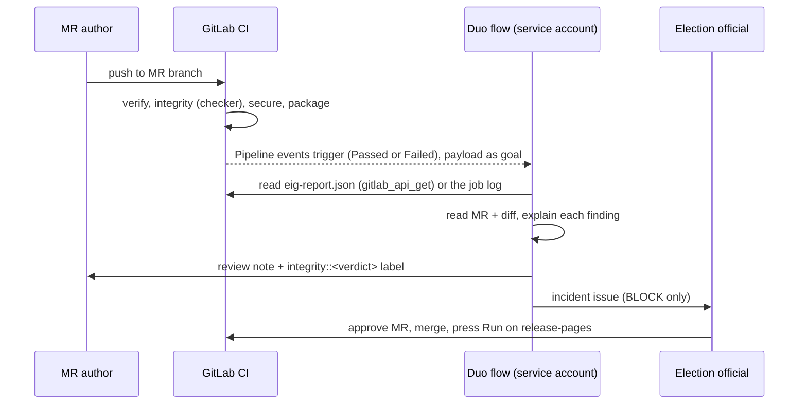

# GitLab Duo Agent Platform setup

This page explains how to turn on the Election Integrity Guard flow and the Integrity Advisor agent.

**Status (2026-10-21):**
- Built in the repository: the flow definition, the agent definition, the labels, and the CI report the flow reads.
- Blocked: creating, enabling and triggering the flow and agent need the **Maintainer** role, and the project owner is a Developer. Maintainer was requested in issue #1.

## What runs today without Maintainer

| Piece | Where | Visible in an MR as |
|---|---|---|
| Deterministic gate | `integrity` CI job | A failed pipeline on BLOCK, plus the "Integrity report" artifact link |
| Findings in the MR | `eig-codequality.json` (Code Quality report, all tiers) | The Code Quality section of the MR widget, with every BLOCK and WARN |
| Report the flow reads | `eig-report.json` artifact, plus JSON between `EIG-REPORT-JSON-BEGIN/END` in the job log | n/a |
| Labels | Created with the API: `integrity::block`, `integrity::warn`, `integrity::pass`, `integrity-incident`, `results-update` | Applied by the flow, once it's enabled |

## Steps for a Maintainer

Docs used:
- Custom flows: https://docs.gitlab.com/user/duo_agent_platform/flows/custom/
- Flow YAML schema: https://docs.gitlab.com/user/duo_agent_platform/flows/custom_flows_schema/
- Triggers: https://docs.gitlab.com/user/duo_agent_platform/triggers/
- Custom agents: https://docs.gitlab.com/user/duo_agent_platform/agents/custom/

### 1. Create the flow

1. Go to **AI > Flows > New flow**.
2. Fill in the form:
   - Display name: `Election Integrity Guard`
   - Description: "Reviews every election-site MR pipeline: explains the deterministic checker report in plain language, labels the MR, and opens an issue for BLOCK findings. Cannot merge, approve or deploy."
   - Visibility: **Private**
3. In **Configuration > Flow**, paste [`.gitlab/duo/flows/integrity-review.yml`](../.gitlab/duo/flows/integrity-review.yml) **without the leading comment block**. It is 7.5 KiB; the limit is 40 KiB.
4. Select **Create flow**.

### 2. Enable the flow

1. Open the flow and select **Enable**, then choose this project.
2. This creates a service account named `ai-<flow>-<group>` with the **Developer** role. `main` is protected, so that account can't merge.
3. Write down the service account's username; the mention trigger uses it.

### 3. Create the triggers

1. Go to **AI > Triggers > New flow trigger**.
2. Description: "Review MR pipelines".
3. Add these conditions:
   - **On an event > Pipeline events**, run when **Passed** and **Failed**
   - **On an event > Mention**
4. Service account: the flow's account.
5. Configuration source: **AI Catalog**, then choose Election Integrity Guard.

### 4. Create the custom agent

Follow [`.gitlab/duo/agents/integrity-advisor.md`](../.gitlab/duo/agents/integrity-advisor.md): create it, select **Enable**, then choose this project.

## How the flow behaves



How it skips work and avoids repeats:
- It skips any pipeline that isn't a finished MR pipeline (`main`, schedules, running).
- It skips a pipeline that already has a review: an existing note has the visible line `EIG Duo review · pipeline <id>`. GitLab rejects HTML comments in flow prompts and strips them from tool output, so the marker is visible text.
- A mention always produces a fresh review.

Its limits:
- **Toolset:** read MR, diff, notes, job logs and the API; write notes, labels and issues. There is no merge, approve or deploy tool.
- **Prompt rule:** `update_merge_request` may only add or remove labels.
- **Hard limit:** the service account has the Developer role, and `main` is protected.

## Plan B, if Maintainer is not granted

Run the same YAML from the GitLab for VS Code flow builder. Checked against the docs on 2026-10-21.

What a Developer can do there ([custom flows](https://docs.gitlab.com/user/duo_agent_platform/flows/custom/)):
- **Run:** "To run a flow: GitLab Duo Agent Platform must be turned on for the project, and you must have at least the Developer role."
- **Publish:** needs "the Maintainer or Owner role for the managing project".
- **Enable and triggers:** "enabling a flow in a project and attaching triggers is done in the GitLab UI only", so Maintainer.

Prerequisites:
- **Extension:** GitLab for VS Code **6.87.0 or later**. The flow builder is beta, introduced with GitLab 19.3.
- **Setting:** `"gitlab.featureFlags.flowBuilder": true` (disabled by default).
- **Agent Platform on for the project:** the project API reports `duo_remote_flows_enabled: true` and `duo_foundational_flows_enabled: true`.
- **Tier:** Premium or Ultimate ([Agent Platform prerequisites](https://docs.gitlab.com/user/duo_agent_platform/)).
- **Where it runs:** flows started in an IDE run locally, not on a CI runner ([flow execution](https://docs.gitlab.com/user/duo_agent_platform/flows/execution/)).

Not confirmed by the docs:
- Which identity the local run writes as. It is probably your own account, not a service account, so the note and label would show your name. Say so on camera.
- Exactly what the Execution Console takes as input.

### 5-minute dry run (Mac)

1. Install the extension: VS Code > Extensions > "GitLab Workflow" (publisher GitLab). Check that the version is ≥ 6.87.0.
2. Run **GitLab: Authenticate** and sign in to gitlab.com with OAuth.
3. Open the settings (`Cmd+,` > Open Settings (JSON)) and add `"gitlab.featureFlags.flowBuilder": true`. Reload the window.
4. Open this repo folder (the git remote must point at the showcase project). Open `.gitlab/duo/flows/integrity-review.yml`, then select **Open GitLab Flow Builder** in the editor title bar.
   - **Gate 1:** the builder renders the `integrity_reviewer` agent with no schema errors.
5. Select **Run**. In the Execution Console, use this goal:
   ```
   Input: review
   Context: {MergeRequest IID: 1}
   ```
   Then select **Execute**.
   - **Gate 2:** tool calls stream: `get_merge_request`, `gitlab_api_get`, and so on.
6. Check MR !1.
   - **Gate 3:** a note starting with `EIG Duo review · pipeline` exists, and the `integrity::block` label is set. Also note which account posted it.
7. If issue creation worked, close the duplicate incident issue it opened. The demo already has issue #2.

If gate 1 or 2 fails, or the Run button is missing or greyed out, switch to Plan C.

## Plan C, if the flow builder also fails for a Developer

Use GitLab's built-in **Code Review** foundational flow. It runs on the Agent Platform, and a Developer can start it ([Code Review flow](https://docs.gitlab.com/user/duo_agent_platform/flows/foundational_flows/code_review/)):
- **Role:** "Have the Developer, Maintainer, or Owner role for the project."
- **Group setting:** **Allow foundational flows** and **Code Review** turned on for the top-level group. That is the organizers' setting; the project reports `duo_foundational_flows_enabled: true`.
- **Trigger:** "Assign `@GitLabDuo` as a reviewer", or `/assign_reviewer @GitLabDuo` in a comment.
- **Customization:** `.gitlab/duo/mr-review-instructions.yaml` with `instructions: [{name, fileFilters, instructions}]`. We can point it at `eig-report.md` and the integrity rules, so the review explains the checker output. Format: [review instructions](https://docs.gitlab.com/user/gitlab_duo/customize_duo/review_instructions/).
  - Caveat: that page lists Duo Enterprise as a prerequisite.

Avoid **Fix pipeline with Duo** on the demo MRs. A Developer can run it ([docs](https://docs.gitlab.com/ci/pipelines/fix_pipeline/)), but it adds code suggestions or opens a new MR that "fixes" the deliberate BLOCK findings. That's the opposite of the demo's point.

**How Plan C holds up against the Duo gate:** it uses the Agent Platform's own flow, steered by repository instructions, next to our custom flow YAML. The custom flow YAML is then shown as built but not enabled, because of the role. That's weaker than A or B. State it plainly in the README.
