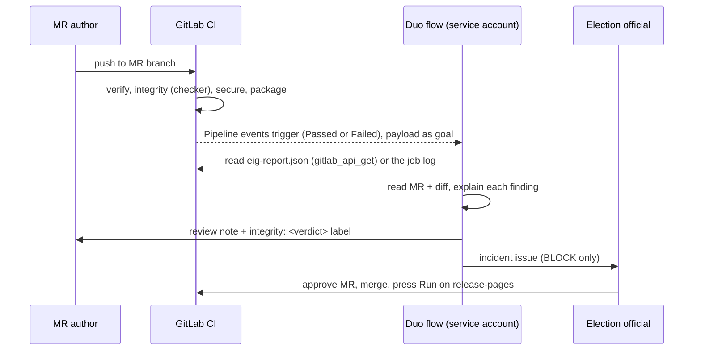

# GitLab Duo Agent Platform setup

This page explains how to turn on the Election Integrity Guard flow and the Integrity Advisor agent.

**Status (2026-10-21):**
- Built in the repository: the flow definition, the agent definition, the labels, and the CI report the flow reads.
- Blocked: creating, enabling and triggering the flow and agent need the **Maintainer** role, and the project owner is a Developer. Maintainer was requested in issue #1.

## What runs today without Maintainer

| Piece | Where | Visible in an MR as |
|---|---|---|
| Deterministic gate | `integrity` CI job | A failed pipeline on BLOCK, plus the "Integrity report" artifact link |
| Findings in the MR | `eig-codequality.json` (Code Quality report, all tiers) | The Code Quality section of the MR widget, with every BLOCK and WARN |
| Report the flow reads | `eig-report.json` artifact, plus JSON between `EIG-REPORT-JSON-BEGIN/END` in the job log | n/a |
| Labels | Created with the API: `integrity::block`, `integrity::warn`, `integrity::pass`, `integrity-incident`, `results-update` | Applied by the flow, once it's enabled |

## Steps for a Maintainer

Docs used:
- Custom flows: https://docs.gitlab.com/user/duo_agent_platform/flows/custom/
- Flow YAML schema: https://docs.gitlab.com/user/duo_agent_platform/flows/custom_flows_schema/
- Triggers: https://docs.gitlab.com/user/duo_agent_platform/triggers/
- Custom agents: https://docs.gitlab.com/user/duo_agent_platform/agents/custom/

### 1. Create the flow

1. Go to **AI > Flows > New flow**.
2. Fill in the form:
   - Display name: `Election Integrity Guard`
   - Description: "Reviews every election-site MR pipeline: explains the deterministic checker report in plain language, labels the MR, and opens an issue for BLOCK findings. Cannot merge, approve or deploy."
   - Visibility: **Private**
3. In **Configuration > Flow**, paste [`.gitlab/duo/flows/integrity-review.yml`](../.gitlab/duo/flows/integrity-review.yml) **without the leading comment block**. It is 7.5 KiB; the limit is 40 KiB.
4. Select **Create flow**.

### 2. Enable the flow

1. Open the flow and select **Enable**, then choose this project.
2. This creates a service account named `ai-<flow>-<group>` with the **Developer** role. `main` is protected, so that account can't merge.
3. Write down the service account's username; the mention trigger uses it.

### 3. Create the triggers

1. Go to **AI > Triggers > New flow trigger**.
2. Description: "Review MR pipelines".
3. Add these conditions:
   - **On an event > Pipeline events**, run when **Passed** and **Failed**
   - **On an event > Mention**
4. Service account: the flow's account.
5. Configuration source: **AI Catalog**, then choose Election Integrity Guard.

### 4. Create the custom agent

Follow [`.gitlab/duo/agents/integrity-advisor.md`](../.gitlab/duo/agents/integrity-advisor.md): create it, select **Enable**, then choose this project.

## How the flow behaves

How it skips work and avoids repeats:
- It skips any pipeline that isn't a finished MR pipeline (`main`, schedules, running).
- It skips a pipeline that already has a review: the marker `<!-- eig-duo-review pipeline:<id> -->` is in an existing note.
- A mention always produces a fresh review.

Its limits:
- **Toolset:** read MR, diff, notes, job logs and the API; write notes, labels and issues. There is no merge, approve or deploy tool.
- **Prompt rule:** `update_merge_request` may only add or remove labels.
- **Hard limit:** the service account has the Developer role, and `main` is protected.

## Plan B, if Maintainer is not granted

Run the same YAML from the GitLab for VS Code flow builder: install the extension, then set `gitlab.featureFlags.flowBuilder` to `true`. A Developer can **run** flows there, and the run can be recorded for the demo. Publishing to the AI Catalog and creating triggers still need Maintainer.
